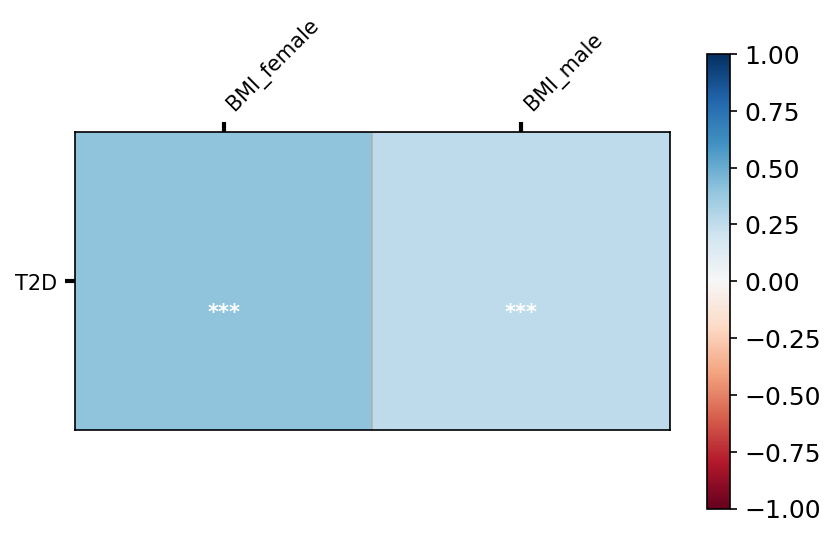

# Results

GWASLab 4.2.3, Python 3.12, synthetic data (seed 2026). Reproduce with:

```bash
python scripts/liftover_walkthrough.py
python scripts/ldsc_walkthrough.py
```

## Liftover

`results/liftover/liftover_steps.tsv`:

| step | build | variants | unmapped |
| --- | --- | --- | --- |
| loaded (`nrows=5000`) | 99 (unknown; tutorial does not set `build`) | 5000 | 0 |
| hg19 → hg38 (bundled chain) | 38 | 4991 | 9 |
| hg38 → T2T-CHM13 (`grch38-chm13v2.chain`) | 13 | 4990 | 1 |

The first SNP's coordinates in each build:

| SNPID | hg19 | hg38 | CHM13 |
| --- | --- | --- | --- |
| 1:752566 (rs3094315) | 752,566 | 817,186 | 246,193 |
| 1:853954 | 853,954 | 918,574 | 348,218 |

How this compares with the tutorial's real data:

- The tutorial drops 8 of its 5,000 variants at hg19 → hg38 and 45 more at
  hg38 → CHM13. Our panel holds only HapMap3 SNPs, which are well-behaved, so
  fewer variants drop out.
- The five unmapped variants the tutorial lists are dropped here as well.
- The status code's build digits change from `99` to `38` to `13`, as on the docs page.

The tests also check three things:

- Over 99.5% of lifted hg38 positions equal dbSNP151's hg38 position for the same rsID.
- BETA, SE and P are unchanged by the liftover.
- Lifting hg19 → hg38 → hg19 returns the original positions.

## LD score regression

| | estimate | truth |
| --- | --- | --- |
| **h2** (`ldsc_h2`) | h2_obs 0.0970 (SE 0.0040) | 0.10 |
| | intercept 1.0397 (0.0161), mean χ² 1.524, λGC 1.472 | 1.03 |
| **rg** T2D–BMI_female | 0.402 (0.041), p = 2.6e-22 | 0.40 |
| **rg** T2D–BMI_male | 0.263 (0.037), p = 1.2e-12 | 0.25 |
| BMI h2 (female / male) | 0.0141 (0.0011) / 0.0170 (0.0011) | 0.015 |
| gcov intercept | 0.005 / −0.004 (SE ≈ 0.01) | 0 (no overlap) |
| **partitioned h2** total | 0.0970 (0.0040) | 0.10 |
| Enhancer: Prop. SNPs / Prop. h2 | 0.099 / 0.310 (0.024) | — |
| Enhancer enrichment | 3.12 (0.24) | 2.82 |
| **cell type** (`ldsc_h2_cts`) | Pancreas p = 4.1e-24; Brain p = 0.022; Liver p = 0.086 | Pancreas |
| h2 after liftover to hg38 | 0.0970 | same as hg19 |



## Notes and gotchas found while running the tutorial

1. **GWASLab 4.2.3 rg bug.** In `extension/ldsc/ldsc_sumstats.py`,
   `smart_merge()` calls `DataFrame.drop('SNP', 1)`. pandas 2 rejects the
   positional `axis` argument, so this raises `TypeError`. GWASLab then hits a
   second error while logging the first one, in `traceback.format_exc(ex)`.
   - The broken code is the fast path, which runs only when two traits have
     **identical SNP lists in the same order**.
   - Real BBJ files never meet that condition. The synthetic BMI files each drop
     a random ~3% of SNPs, as real QC would.
   - The bug was still present on the GWASLab `main` branch when this was written.
2. **Scratch files.** The LDSC functions write `ldsc.delete` and
   `ldsc.part_delete` to the current directory. The walkthrough runs inside
   `--outdir`, and the tests use a temporary directory.
3. **Paths in `.ldcts` files** are split on whitespace, so they must not contain spaces.
4. **Built-in HapMap3 extraction.** `estimate_*_by_ldsc` extract HapMap3 SNPs
   themselves, by `CHR:POS` for the sumstats' build. They therefore work after
   a liftover once `build` is `"38"`; there is no need to call `filter_hapmap3`
   first.
